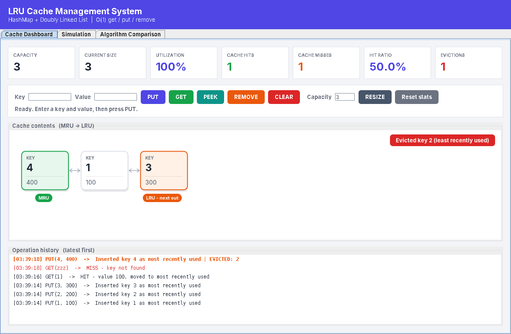
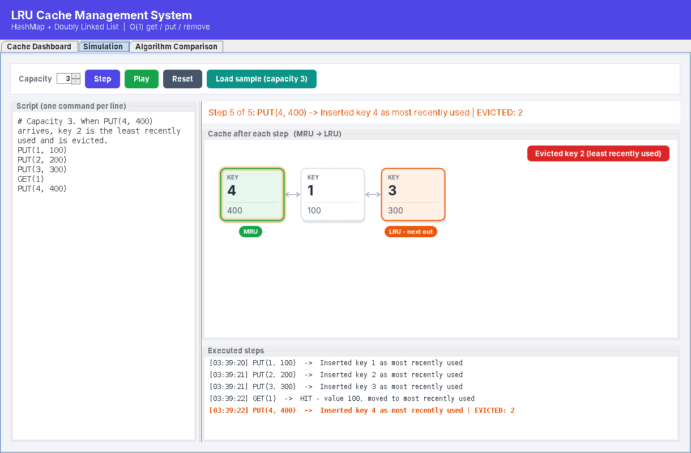
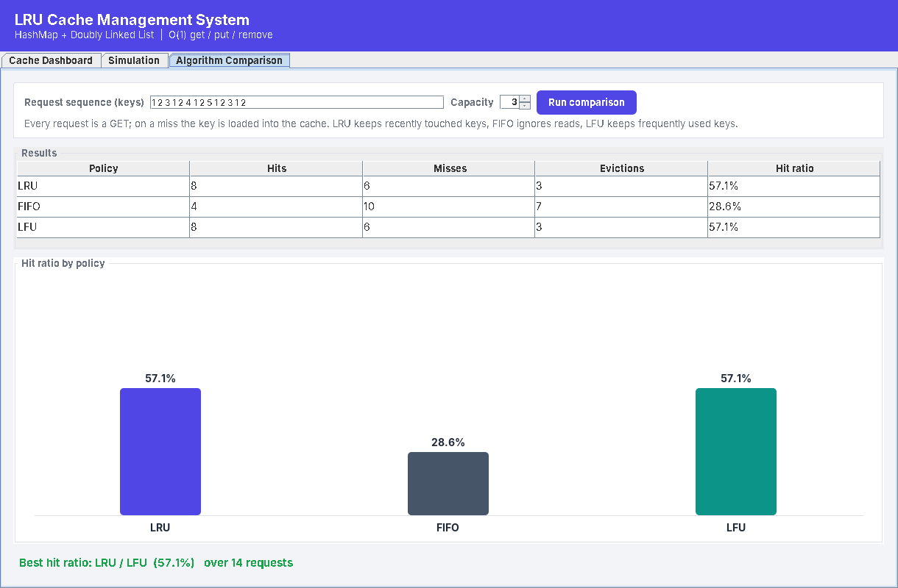

# LRU Cache Management System

A complete **Least Recently Used (LRU) cache** in Java 17 with an interactive Swing dashboard, a step-by-step
simulator and an LRU / FIFO / LFU comparison tool.
Core engine: **HashMap + custom doubly linked list**, giving **O(1)** `get`, `put`, `remove` and `peek`.

**Tech:** Java 17, DSA, OOP, Java Collections, Java Swing, Maven, JUnit 5 (no other dependencies)



## Features

| Area | What you get |
| --- | --- |
| Cache operations | `PUT`, `GET`, `PEEK` (no reorder), `REMOVE`, `CLEAR`, `DISPLAY` (MRU to LRU), `RESIZE` (auto-evicts) |
| Dashboard | Capacity, size, utilization, hits, misses, hit ratio, eviction count, colour-coded operation history |
| Visualizer | Cards ordered MRU to LRU, doubly-linked arrows, MRU / LRU badges, gold glow on the accessed key, animated move-to-front, red sink animation + toast on eviction, dashed empty slots showing capacity |
| Simulation | Script editor, Step / Play / Reset, one-click capacity-3 demo, per-step explanation |
| Algorithm comparison | Same request sequence replayed on LRU, FIFO and LFU with a hit-ratio table and chart |
| Validation | Blank/null keys, empty values, invalid or non-numeric capacity, missing keys, duplicate keys (update), bad simulation scripts (with line numbers) |
| Tests | 48 JUnit 5 tests, including a 20,000-operation randomized check against `LinkedHashMap` |

## Run it

```bash
mvn test                      # run the unit tests
mvn package                   # build target/lru-cache-management-system-1.0.0.jar
java -jar target/lru-cache-management-system-1.0.0.jar        # asks for the initial capacity
java -jar target/lru-cache-management-system-1.0.0.jar 8      # or pass it directly
```

Requires JDK 17+ and Maven 3.8+. Without Maven: `javac -d out $(find src/main -name "*.java")` then `java -cp out com.lru.Main`.

## Project structure

```
LRU-Cache-Management-System/
├── pom.xml
├── README.md
├── docs/screenshots/
└── src/
    ├── main/java/com/lru/
    │   ├── Main.java                    entry point, look and feel, initial capacity prompt
    │   ├── cache/
    │   │   ├── Cache.java               interface shared by all eviction policies
    │   │   ├── AbstractCache.java       capacity, validation, eviction listener (template)
    │   │   ├── LRUCache.java            HashMap + doubly linked list   <- the core
    │   │   ├── Node.java                key, value, prev, next
    │   │   ├── FIFOCache.java           baseline for comparison
    │   │   ├── LFUCache.java            O(1) frequency-bucket baseline
    │   │   ├── CacheEntry.java          immutable snapshot record for the UI
    │   │   ├── EvictionListener.java    callback fired on automatic eviction
    │   │   └── CacheManager.java        facade: validation, statistics, history, listeners
    │   ├── model/
    │   │   ├── CacheOperation.java      immutable record of an executed operation
    │   │   ├── CacheCommand.java        a parsed, not yet executed command
    │   │   ├── CacheStatistics.java     hits, misses, evictions, hit ratio
    │   │   └── OperationType.java
    │   ├── exception/                   CacheException + InvalidKey / InvalidValue / InvalidCapacity
    │   ├── simulation/
    │   │   ├── CommandParser.java       "PUT(1, 100)" text -> CacheCommand
    │   │   └── PolicyComparator.java    replays a workload on LRU / FIFO / LFU
    │   └── ui/
    │       ├── Dashboard.java           main window, stats, controls, history
    │       ├── CacheVisualizer.java     animated cache drawing
    │       ├── SimulationPanel.java     step-by-step simulator
    │       ├── ComparisonPanel.java     policy comparison + bar chart
    │       └── Theme.java, StyledButton.java, OperationRenderer.java
    └── test/java/com/lru/
        ├── cache/LRUCacheTest.java, CacheManagerTest.java, EvictionPolicyTest.java
        └── simulation/SimulationTest.java
```

### Layering

```
 ui (Swing)  ->  CacheManager (facade)  ->  Cache interface  ->  LRUCache / FIFOCache / LFUCache
                      |                                                  |
              CacheStatistics, CacheOperation                      HashMap + Node list
```

The UI never touches the cache directly, and the cache has no Swing dependency, so the engine can be reused or tested alone.

## The LRU algorithm

An LRU cache evicts the entry that has gone unused the longest. Two things must be fast at once:

1. **Find** an entry by key.
2. **Reorder** entries by recency and **evict** the oldest one.

| Need | Structure | Why |
| --- | --- | --- |
| Find by key | `HashMap<K, Node>` | O(1) average lookup |
| Recency order | Doubly linked list | O(1) move-to-front and O(1) removal from the back |

```
            HashMap<K, Node>
        ┌───────┬───────────┐
        │  key  │   node    │
        ├───────┼───────────┤
        │   4   │ ────────────────┐
        │   1   │ ──────────┐     │
        │   3   │ ───┐      │     │
        └───────┴────│──────│─────│─────────
                     │      │     │
   head ⇄ [4=400] ⇄ [1=100] ⇄ [3=300] ⇄ tail          (head/tail are sentinel nodes)
          └─ MRU                └─ LRU (evicted next)
```

**GET(k):** look up the node in the map, unlink it, re-insert it right after `head` (now the MRU), return the value.
**PUT(k, v):** if the key exists, update the value and move the node to the front. Otherwise create a node, put it in the map and at the front; if `size > capacity`, take the node just before `tail`, unlink it and delete its key from the map.
**REMOVE(k):** remove from the map and unlink the node.
**PEEK(k):** map lookup only, so the list is not touched.

### Walk-through (capacity 3)

```
PUT(1,100)  [1]
PUT(2,200)  [2, 1]
PUT(3,300)  [3, 2, 1]
GET(1)      [1, 3, 2]          1 moved to the front, 2 is now the LRU
PUT(4,400)  [4, 1, 3]          full -> key 2 evicted
```

### Design decisions worth explaining

* **Why a doubly linked list?** After the map hands us a node, we must unlink it without searching for its neighbours. `prev` and `next` give O(1) unlinking. A singly linked list would need an O(n) walk to find the predecessor.
* **Why store the key inside `Node`?** On eviction we reach the LRU node through the list and must also delete its entry from the map; the node tells us which key to remove.
* **Why sentinel head/tail nodes?** They remove every "is this the first / last node?" branch, so there are no null checks and fewer bugs.
* **Why not a PriorityQueue?** Priority (a timestamp) changes on every access. Updating an element's priority needs `remove(Object)`, which is O(n) in `java.util.PriorityQueue`, followed by an O(log n) re-insert. An indexed heap could reach O(log n) but still cannot beat O(1), and it adds complexity and tie-break handling for no benefit. HashMap + doubly linked list is the standard O(1) answer.
* **Why a `Cache` interface and `AbstractCache`?** Polymorphism: the manager and comparator work with any policy, and shared concerns (validation, capacity, listener) live in one place.

## Complexity

| Operation | Time | Notes |
| --- | --- | --- |
| `get` | O(1) | map lookup + pointer rewiring |
| `put` | O(1) | includes an eviction when full |
| `remove` | O(1) | |
| `peek` | O(1) | no reorder |
| `containsKey`, `size` | O(1) | |
| `clear` | O(n) | clears the map |
| `display` / `entries()` | O(n) | walks the list |
| `resize(c)` | O(k) | k = entries evicted when shrinking |

**Space:** O(n) for n entries, one map entry plus one node each (two extra references per node).
Hash lookups are O(1) on average, assuming a reasonable `hashCode`.

## Error handling

| Situation | Behaviour |
| --- | --- |
| Null, empty or blank key | `InvalidKeyException` |
| Null or blank value | `InvalidValueException` |
| Capacity <= 0 or not a number | `InvalidCapacityException` / `CacheException` |
| Duplicate key on `PUT` | Updates the value and refreshes recency |
| `GET` / `PEEK` / `REMOVE` on a missing key | Returns a failed `CacheOperation` ("MISS" / "not found"), no exception |
| Capacity overflow | Evicts the LRU entry and reports it |
| Bad simulation script | `CacheException` naming the line, e.g. `Line 2: Cannot understand 'HELLO(2)'...` |

The UI catches `CacheException` and shows the message in the status line, so invalid input never crashes the app.
`PEEK` is not counted as a hit or a miss, because it is not a real access.

## Tests

```
mvn test
```

48 tests across 4 classes: insertion and retrieval, updates, LRU eviction, access-order changes, `peek`, remove, clear,
resize (shrink, grow, invalid), capacity 1, hit/miss statistics, validation, history limits, parser errors, FIFO/LFU behaviour,
and a randomized comparison with `LinkedHashMap(accessOrder=true)`.

Sample (capacity 3), produced by the manager:

```
PUT(1, 100)  ->  Inserted key 1 as most recently used            [1=100]
PUT(2, 200)  ->  Inserted key 2 as most recently used            [2=200, 1=100]
PUT(3, 300)  ->  Inserted key 3 as most recently used            [3=300, 2=200, 1=100]
GET(1)       ->  HIT - value 100, moved to most recently used    [1=100, 3=300, 2=200]
PUT(4, 400)  ->  Inserted key 4 ... | EVICTED: 2                 [4=400, 1=100, 3=300]
PEEK(3)      ->  Value 300 (usage order unchanged)               [4=400, 1=100, 3=300]
RESIZE(1)    ->  Capacity 3 -> 1 | EVICTED: 3, 1                 [4=400]
```

## Simulation and comparison

| Simulation | Comparison |
| --- | --- |
|  |  |

Simulation script syntax (one command per line, `#` starts a comment):

```
PUT(key, value)   GET(key)   PEEK(key)   REMOVE(key)   CLEAR()   RESIZE(n)
```

Comparison workload `1 2 3 1 2 4 1 2 5 1 2 3 1 2` with capacity 3: LRU 8 hits, FIFO 4 hits, LFU 8 hits.
LRU is not always the winner; try `1 2 3 4 1 2 5 1 2 3 4 5` to see FIFO come out ahead on a cyclic pattern.

## Interview talking points

* **How does eviction stay O(1)?** The LRU node is always `tail.prev`; unlinking it is four pointer assignments and removing its key from the map is O(1).
* **Why both a map and a list?** The map alone has no order, the list alone has O(n) lookup. Together each covers the other's weakness.
* **What breaks thread safety?** `get` mutates the list, so even reads need a lock. Options: `synchronized` / `ReentrantLock`, or sharding by key hash.
* **Alternative implementation?** `LinkedHashMap(capacity, 0.75f, true)` + `removeEldestEntry`; this project builds it by hand to show the mechanism (and uses that class as the oracle in a test).
* **How would you scale it?** Add TTL expiry, segmented locks, or an LRU-K / ARC policy for scan resistance.

## Resume bullets

* Built an LRU Cache Management System in Java using a HashMap and a custom doubly linked list, achieving O(1) get/put/remove; validated with 48 JUnit 5 tests including a randomized check against `LinkedHashMap`.
* Designed a layered architecture (Cache interface, abstract base, manager facade, Swing UI) with interchangeable LRU / FIFO / LFU policies.
* Developed a Swing dashboard with animated cache visualization, live hit/miss analytics, a scriptable step-through simulator and a policy comparison tool.
